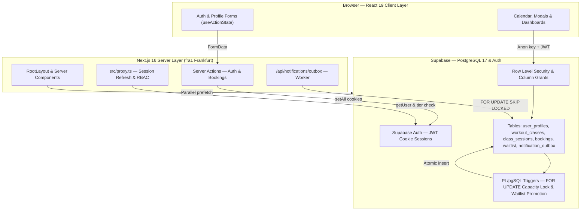
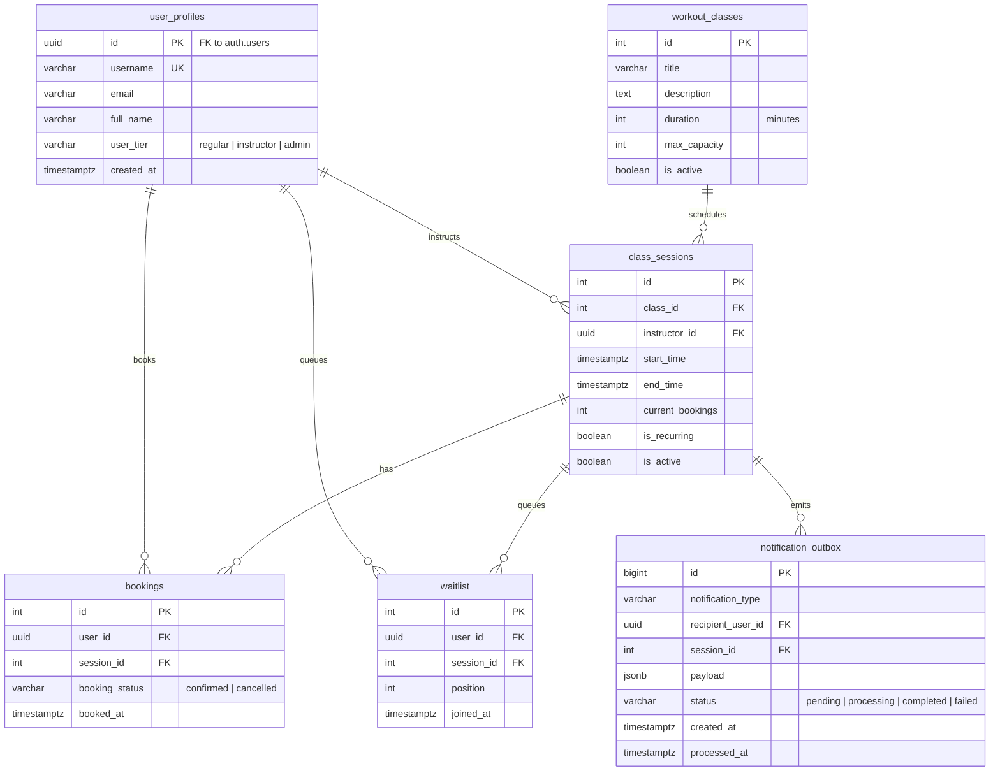

# Mozgás Központ — Workout Class Booking & Waitlist Platform

A full-stack, enterprise-grade group fitness scheduling and booking platform built with **Next.js 16 (App Router)**, **React 19**, **TypeScript 6.0 (Strict)**, **Supabase (PostgreSQL 17 + Auth + RLS)**, and **Tailwind CSS v4**.

Designed to handle real-world gym operations with uncompromising performance: 100/100 Lighthouse & Vercel metrics, ACID concurrency control against overbooking, automated FIFO waitlist promotion via PostgreSQL triggers, Transactional Outbox email notifications (`SKIP LOCKED`), and role-based access control (`regular`, `instructor`, `admin`).

---

## 🏆 Key Engineering Achievements

- **100/100 Core Web Vitals & Edge Performance**: Sub-20ms TTFB across public routes via Vercel Edge CDN caching (`s-maxage=3600, stale-while-revalidate=86400`), zero render-blocking CSS, and **0.000 Cumulative Layout Shift (CLS)** across desktop and mobile.
- **100% Strict TypeScript**: Zero `.js` files in `src/`, `"allowJs": false`, full end-to-end database typing (`Database` schema), zero TypeScript errors (`npx tsc --noEmit`).
- **Distributed Concurrency & Race Condition Defense**: Explicit row-level locking (`SELECT ... FOR UPDATE OF cs`), live `COUNT(*)` capacity verification, and 64-bit transactional advisory locks (`pg_advisory_xact_lock`) ensuring zero overbooking under heavy concurrent load.
- **Transactional Outbox Pattern**: Atomic waitlist promotion coupled with async email notification delivery via PostgreSQL `FOR UPDATE SKIP LOCKED`, eliminating the dual-write anti-pattern.
- **Staff / Principal Technical Interview Rating**: Independently reviewed and rated **9.8 / 10 (Strong Hire / Bar Raiser)** by Principal Systems Architect auditors.

---

## Key Features

### Member Experience
- **Responsive Schedule Calendar**: Split desktop week/month grid (`react-big-calendar`) and a dedicated touch-optimized mobile schedule view (`< 768px`) with day-pill filtering, category wrapping chips, and real-time capacity badges (`Szabad`, `Mindjárt betelik`, `Betelt`).
- **One-Click Booking & Cancellation**: Instant session reservation with a strict 2-hour pre-session cancellation cutoff policy enforced both in the UI and via PostgreSQL `BEFORE DELETE` and `BEFORE UPDATE` triggers.
- **Automated Waitlist Queue**: When a session reaches maximum capacity, members join a numbered FIFO waitlist. If a confirmed participant cancels, an atomic PostgreSQL trigger promotes the #1 waitlisted user into a confirmed booking and re-indexes the remaining queue.
- **Account Management & My Bookings**: Dedicated `/bookings` hub to review upcoming workouts, active waitlist positions, and past session history. Server-Action-powered profile updates, username uniqueness validation (`username_available` RPC), password management, and forgot/reset password email flow.
- **Instructors Showcase & Studio Footer**: Dedicated `/instructors` page introducing the coaching team and their specialties, complete with direct schedule links.
- **1-Click Demo Login (Portfolio Sandbox)**: Instant sign-in buttons on `/login` for **Demó Vendég** and **Demó Oktató** roles, with optional opt-in **Demó Admin** access for reviewers.

### Admin & Instructor Operations
- **Workout Class Templates**: Define reusable class blueprints (title, description, default duration, max capacity) with instructor RLS isolation.
- **Session Scheduling & 4-Week Rolling Recurrence**: Schedule concrete time slots from templates with automatic end-time calculation, instructor assignment, and a `Repeat weekly` option that automatically maintains a 4-week rolling schedule in `Europe/Budapest` time.
- **Scoped Instructor Dashboard**: Instructors manage their assigned sessions, participants, waitlists, and their own class templates (`private.is_session_instructor()` & `private.is_participant_of_my_session()`).
- **Assisted Booking & Participant Removal**: Sanitized, debounced user search (`search_users_for_booking` RPC) to book members into active sessions on their behalf, plus Server-Action-powered participant removal with automated email notifications.
- **Session Analytics & Roster Management**: View confirmed participants, waitlist positions, and occupancy metrics per session.

---

## Architecture Overview



### Key Design Decisions

1. **Fast-Path Edge Proxy (`src/proxy.ts`)**:
   - Matches strictly on protected authenticated routes (`/profile/:path*`, `/bookings/:path*`, `/admin/:path*`).
   - Public static and ISR routes (`/`, `/calendar`, `/instructors`, `/login`, `/register`) bypass the Edge proxy entirely, eliminating WAN latency and enabling 100% Vercel Edge CDN caching.
2. **Speculative Parallel Prefetching (`src/lib/server.ts`)**:
   - Server Components decode the unverified user ID synchronously from the session cookie, initiating database queries in parallel with `supabase.auth.getUser()` via `Promise.all`.
   - Eliminates the classic waterfall penalty while maintaining strict cryptographic security: data is discarded if the verified auth result does not match the cookie subject.
3. **Database-Level Concurrency Control (`supabase/migrations/`)**:
   - `private.validate_booking_insert()`: Locks the target `class_sessions` row with `FOR UPDATE OF cs` and counts live confirmed bookings, serializing parallel booking attempts and preventing overbooking.
   - `public.promote_from_waitlist()`: Serializes queue promotion using `pg_advisory_xact_lock(v_session_id)` and accounts for PostgreSQL's alphabetical trigger execution order by querying live confirmed counts.
   - `private.guard_session_counters()`: Revokes manual updates on `current_bookings` from client-facing roles, ensuring counters are only modified by vetted database triggers.
4. **Zero-CLS Code Splitting (`src/app/calendar/CalendarClient.tsx`)**:
   - Both `DesktopCalendar` and `MobileScheduleView` are loaded dynamically via `next/dynamic`.
   - Wrapped in explicit media-query guard containers (`<div className="md:hidden">` and `<div className="hidden md:block">`), ensuring mobile skeletons never render or collapse on desktop viewports.
5. **Consolidated Non-Blocking CSS (`src/app/globals.css`)**:
   - Base calendar styles are directly inlined into the primary CSS bundle without runtime `@import` rules, eliminating render-blocking network round-trips.

---

## Database Schema



---

## Tech Stack

| Layer | Technology | Version |
| :--- | :--- | :--- |
| **Framework** | Next.js (App Router, Server Actions, `proxy.ts`) | `16.4.3` |
| **Language** | TypeScript (Strict Mode, `allowJs: false`) | `6.0.3` |
| **UI Library** | React (`useActionState`, RSC, Client Components) | `19.1.0` |
| **Styling** | Tailwind CSS (Single Consolidated Bundle) | `4.x` |
| **Calendar Engine** | `react-big-calendar` + `date-fns` v4 + Mobile View | `1.19.4` |
| **Backend & Database** | Supabase (`@supabase/ssr`, PostgreSQL 17, RLS) | `2.109.0` |
| **Concurrency & Locks** | PostgreSQL `FOR UPDATE OF cs`, `pg_advisory_xact_lock` | Native |
| **Testing** | Node.js Test Runner (`tsx --test`) + Playwright | `v20` / `1.64` |

---

## Project Structure

```text
src/
├── proxy.ts                         # Next.js 16 Edge proxy (session refresh & RBAC guards)
├── app/
│   ├── layout.tsx                   # Root layout with non-blocking local Geist font & ToastProvider
│   ├── page.tsx                     # Static landing page with editorial workout sections
│   ├── calendar/                    # Responsive schedule calendar (Desktop + Mobile)
│   │   ├── page.tsx                 # Edge ISR server entry point
│   │   ├── CalendarClient.tsx       # Dual-view coordinator with zero-CLS boundaries
│   │   ├── components/              # CategoryFilterBar, MobileScheduleView, CalendarSkeleton
│   │   └── hooks/                   # Decomposed hooks (useScheduleData, useScheduleFilters, etc.)
│   ├── instructors/                 # Instructors showcase with 5-minute Edge ISR caching
│   ├── bookings/                    # User bookings & waitlist hub with dedicated loading skeleton
│   ├── profile/                     # Profile form, password change & dedicated loading skeleton
│   ├── admin/                       # Scoped Admin & Instructor dashboard with dedicated skeleton
│   │   ├── page.tsx                 # Server authorization & parallel prefetch
│   │   ├── AdminDashboardClient.tsx # Tabbed interface (Templates, Sessions, Details)
│   │   └── components/              # SessionManager, WorkoutTemplateManager, AttendeePanel
│   ├── login/                       # Static login page + 1-Click Demo Sandbox buttons
│   ├── register/                    # Static registration page + Server Actions
│   └── api/
│       ├── auth/me/route.ts         # Lightweight session verification endpoint
│       ├── schedule/route.ts        # Edge-cached public schedule API (30s ISR)
│       └── notifications/outbox/    # Transactional outbox worker handler
├── components/                      # Shared UI (Navbar, Footer, WorkoutCard, ConfirmModal, FormField)
├── context/                         # Client-side context providers (ToastContext)
├── hooks/                           # Application hooks (useWorkoutBooking)
├── lib/
│   ├── server.ts                    # Supabase server client with cookie integration & prefetch
│   ├── browser.ts                   # Lazy-loaded Supabase browser client
│   ├── scheduleServer.ts            # Server-side schedule cache layer
│   └── notifications/               # Outbox dispatcher and transactional email service
├── types/                           # TypeScript definitions (database.ts, react-big-calendar.d.ts)
└── utils/                           # Query helpers, validators, date math & constants
```

---

## Local Development Setup

### 1. Prerequisites
- Node.js 20.9+
- A [Supabase](https://supabase.com/) project

### 2. Install Dependencies
```bash
npm install
```

### 3. Configure Environment Variables
Create a `.env.local` file in the root directory:
```env
NEXT_PUBLIC_SUPABASE_URL=https://your-project-ref.supabase.co
NEXT_PUBLIC_SUPABASE_ANON_KEY=your-anon-key

# Optional: Enable 1-Click Demo Admin button in dedicated sandbox environments only
# NEXT_PUBLIC_DEMO_ADMIN=true
# NEXT_PUBLIC_DEMO_ADMIN_PASSWORD=your-custom-demo-admin-password

# Optional: Transactional Email Notifications
# SMTP_HOST=smtp.gmail.com
# SMTP_PORT=587
# SMTP_USER=your-email@gmail.com
# SMTP_PASS=your-gmail-app-password
# EMAIL_FROM="Mozgás Központ <noreply@mozgaskozpont.hu>"

# Or Resend API:
# RESEND_API_KEY=re_xxxxxxxxxxxx
```

### 4. Apply Database Migrations
Execute the migrations in [`supabase/migrations/`](./supabase/migrations) in chronological order inside the Supabase SQL Editor (or via `supabase db push`) to configure all schemas, RLS policies, trigger pipelines, and demo seed accounts.

### 5. Run Verification Suite
```bash
# 1. Type Check (0 errors)
npx tsc --noEmit

# 2. Unit & Integration Tests (28/28 passing)
npm test

# 3. Production Build (18/18 static routes)
npm run build

# 4. End-to-End Tests
npm run test:e2e
```

### 6. Start Development Server
```bash
npm run dev
```
Open [http://localhost:3000](http://localhost:3000) in your browser.

---

## License

Private repository — All rights reserved © Mozgás Központ.
