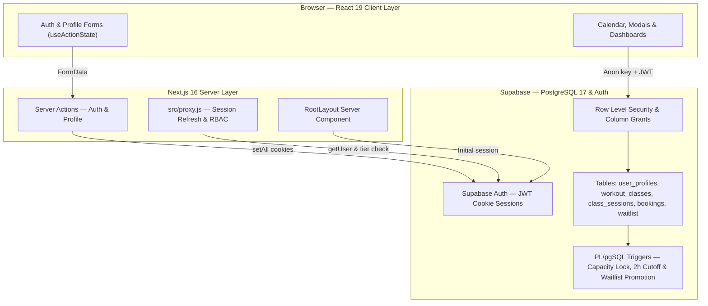
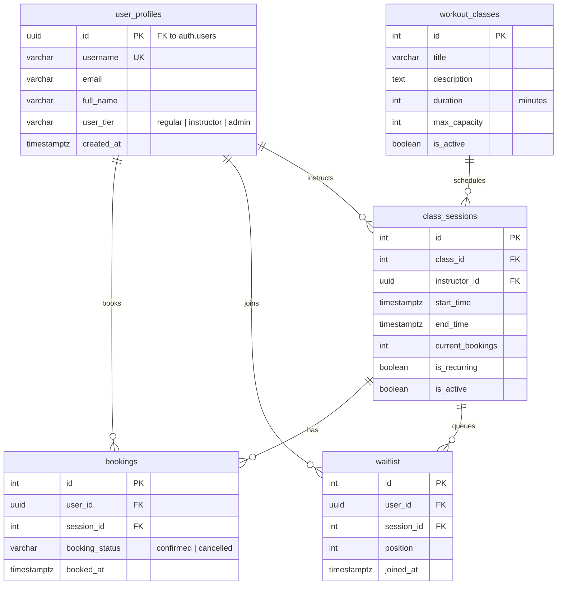

# Mozgás Központ — Workout Class Booking & Waitlist Platform

A full-stack group fitness scheduling and booking platform built with **Next.js 16 (App Router)**, **React 19**, **Supabase (PostgreSQL + Auth + RLS)**, and **Tailwind CSS v4**.

Designed to handle real-world gym operations: template-based class scheduling, live capacity tracking, automated FIFO waitlist promotion via PostgreSQL triggers, and role-based access control (`regular`, `instructor`, `admin`).

---

## Key Features

### Member Experience
- **Responsive Schedule Calendar**: Desktop week/month calendar (`react-big-calendar`) and a dedicated touch-friendly mobile schedule view (`< 768px`) with day-pill filtering and real-time capacity badges (`Available`, `Almost Full`, `Full`).
- **One-Click Booking & Cancellation**: Instant session reservation with a 2-hour pre-session cancellation cutoff policy enforced both in the UI and via PostgreSQL `BEFORE DELETE` and `BEFORE UPDATE` triggers.
- **Automated Waitlist Queue**: When a session reaches capacity, members can join a numbered waitlist. If a confirmed participant cancels, a PostgreSQL trigger automatically promotes the #1 waitlisted user into a confirmed booking and re-indexes the remaining queue.
- **Account Management & Password Recovery**: Server-Action-powered profile updates, username uniqueness validation (`username_available` RPC), password management, forgot/reset password email flow, and booking history (Upcoming, Past, and Waitlist).
- **1-Click Demo Login (Portfolio Sandbox)**: Instant sign-in buttons on `/login` for **Demo Member** and **Demo Coach** roles, with optional opt-in **Demo Admin** access via environment configuration.

### Admin & Instructor Operations
- **Workout Class Templates (Admin)**: Define reusable class blueprints (title, description, default duration, max capacity).
- **Session Scheduling & 4-Week Rolling Recurrence (Admin & Coach)**: Schedule concrete time slots from templates with automatic end-time calculation, instructor assignment, and a `Repeat weekly` option that automatically maintains a 4-week rolling schedule in `Europe/Budapest` time and purges expired sessions older than 14 days via `pg_cron`.
- **Scoped Coach Dashboard**: Instructors manage only their own assigned sessions, participants, and waitlists (`private.is_session_instructor()` & `private.is_participant_of_my_session()`).
- **Manual Assisted Booking**: Sanitized, debounced user search (`search_users_for_booking` RPC) to book members into active sessions on their behalf.
- **Session Analytics & Roster Management**: View confirmed participants, waitlist positions, and occupancy metrics per session.

---

## Architecture Overview

The app uses the Next.js App Router (Server Components + Server Actions) for authentication and route protection, paired with Supabase PostgreSQL (Row Level Security + PL/pgSQL triggers) for data access and booking rules:



### Key Design Decisions
1. **Route Protection (`src/proxy.js`)**:
   - Refreshes Supabase Auth session cookies before Server Components render.
   - Protects `/profile` and `/admin` routes on the server, verifies `user_tier IN ('admin', 'instructor')` before allowing access to `/admin/*`, and redirects logged-in users away from `/login` and `/register`.
2. **Server Actions (`useActionState`)**:
   - Auth (`/login`, `/register`, `/forgot-password`, `/reset-password`) and profile forms (`/profile`) use Next.js Server Actions (`'use server'`) with `@supabase/ssr` cookie handling (`getAll` / `setAll`), unified login error responses to prevent account enumeration, and Auth-first email update ordering.
3. **Database Triggers & Row Level Security (`supabase/migrations/`)**:
   - Core booking rules are enforced in PostgreSQL so they cannot be bypassed from the client:
     - `private.validate_booking_insert()` & `private.validate_booking_update()`: Lock the target `class_sessions` row with `SELECT ... FOR UPDATE OF cs` and count live confirmed bookings to prevent concurrent overbooking or status tampering.
     - `private.validate_booking_delete()`: Enforces the 2-hour cancellation cutoff in the database for regular users while allowing admins, the session's assigned instructor, and scheduled cleanup jobs.
     - `public.promote_from_waitlist()` & `public.manage_waitlist_positions()`: Serializes waitlist positions per session with `pg_advisory_xact_lock` and automatically promotes `position = 1` into `bookings` using live confirmed counts when a spot opens up.
     - `private.guard_session_counters()` & `public.prevent_user_tier_change()`: Block client attempts to spoof `current_bookings` or escalate `user_tier`.

---

## Database Schema



---

## Tech Stack

| Layer | Technology |
| :--- | :--- |
| **Framework** | Next.js 16.4 (App Router, Server Actions, `proxy.js`) |
| **UI Library** | React 19 (`useActionState`, Client & Server Components) |
| **Styling** | Tailwind CSS v4 + CSS Modules (Calendar customization) |
| **Calendar** | `react-big-calendar` + `date-fns` v4 + Mobile Schedule View |
| **Backend & Auth** | Supabase (`@supabase/ssr`, `@supabase/supabase-js`, PostgreSQL 17) |
| **Security** | PostgreSQL Row Level Security (RLS), Column Grants, `SECURITY DEFINER` RPCs |

---

## Project Structure

```text
src/
├── proxy.js                        # Next.js 16 request proxy (session refresh & RBAC guards)
├── app/
│   ├── layout.js                   # Root Server Component layout (fetches initial auth user)
│   ├── page.js                     # Landing page with IntersectionObserver animations
│   ├── calendar/                   # Desktop calendar & mobile workout schedule + booking modal
│   ├── login/                      # Login page + Server Action (loginAction)
│   ├── register/                   # Registration page + Server Action (registerAction)
│   ├── profile/                    # User profile, bookings list & Server Actions
│   └── admin/                      # Admin & Instructor dashboard (Templates, Sessions, Roster)
├── components/                     # Reusable UI components (Navbar, WorkoutCard, ConfirmModal, Forms)
├── hooks/                          # Custom hooks (useWorkoutBooking)
├── lib/
│   ├── browser.js                  # Supabase browser client (@supabase/ssr)
│   └── server.js                   # Supabase server client with cookie store integration
└── utils/                          # Query helpers, validators, date formatters & constants
```

---

## Local Development Setup

### 1. Prerequisites
- Node.js 20.9+
- A [Supabase](https://supabase.com/) project

### 2. Install Dependencies
```bash
npm install
```

### 3. Configure Environment Variables
Create a `.env.local` file in the root directory:
```env
NEXT_PUBLIC_SUPABASE_URL=https://your-project-ref.supabase.co
NEXT_PUBLIC_SUPABASE_ANON_KEY=your-anon-key

# Optional: Enable 1-Click Demo Admin button in dedicated sandbox environments only
# NEXT_PUBLIC_DEMO_ADMIN=true
# NEXT_PUBLIC_DEMO_ADMIN_PASSWORD=your-custom-demo-admin-password

# Optional: Transactional Email Notifications (Session updates and cancellations)
# Option A: Nodemailer SMTP (e.g. Gmail App Password, Brevo, Mailgun)
# SMTP_HOST=smtp.gmail.com
# SMTP_PORT=587
# SMTP_USER=your-email@gmail.com
# SMTP_PASS=your-gmail-app-password
# EMAIL_FROM="Mozgás Központ <noreply@mozgaskozpont.hu>"

# Option B: Resend API (Free 3,000 emails/month)
# RESEND_API_KEY=re_xxxxxxxxxxxx

# Optional: Admin notification inbox for session cancellation/modification alerts
# ADMIN_NOTIFICATION_EMAIL=admin@mozgaskozpont.hu
```
> **Security Note:** Never enable `NEXT_PUBLIC_DEMO_ADMIN=true` on a database containing real member data. Migration `20261030000000_security_and_integrity_fixes.sql` automatically rotates the `demo_admin` password away from the default seed password unless `app.demo_admin_password` is explicitly configured in PostgreSQL.

### 4. Apply Database Migrations
Run the SQL migrations in [`supabase/migrations/`](./supabase/migrations) in chronological order inside the Supabase SQL Editor (or via `supabase db push` with the Supabase CLI) to set up all tables, indexes, RLS policies, `pg_cron` recurring session jobs, concurrency/cancellation triggers, and demo accounts.

### 5. Run Linter & Tests
```bash
npm run lint
npm test
```

### 6. Start the Development Server
```bash
npm run dev
```
Open [http://localhost:3000](http://localhost:3000) in your browser.
