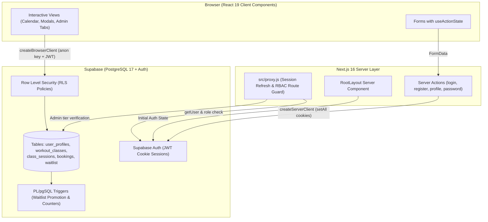
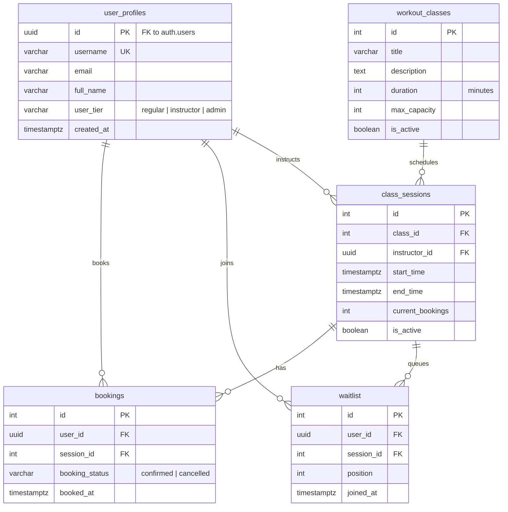

# Mozgás Központ — Workout Class Booking & Waitlist Platform

A full-stack group fitness scheduling and booking platform built with **Next.js 16 (App Router)**, **React 19**, **Supabase (PostgreSQL + Auth + RLS)**, and **Tailwind CSS v4**.

Designed to handle real-world gym operations: template-based class scheduling, live capacity tracking, automated FIFO waitlist promotion via PostgreSQL triggers, and role-based access control (`regular`, `instructor`, `admin`).

---

## Key Features

### Member Experience
- **Interactive Schedule Calendar (`react-big-calendar`)**: Browse classes in Month or Week view with real-time capacity indicators (`Available`, `Almost Full`, `Full`).
- **One-Click Booking & Cancellation**: Instant session reservation with a 2-hour pre-session cancellation cutoff policy enforced both in the UI and via PostgreSQL `BEFORE DELETE` triggers.
- **Automated Waitlist Queue**: When a session reaches capacity, members can join a numbered waitlist. If a confirmed participant cancels, a PostgreSQL trigger automatically promotes the #1 waitlisted user into a confirmed booking and re-indexes the remaining queue.
- **Account Management & Password Recovery**: Server-Action-powered profile updates, username uniqueness validation, password management, forgot/reset password email flow, and booking history (Upcoming, Past, and Waitlist).
- **1-Click Demo Login (Recruiter Sandbox)**: Instant sign-in buttons on `/login` for both **Demo Member** and **Demo Admin** roles without registration.

### Admin & Instructor Operations
- **Workout Class Templates**: Define reusable class blueprints (title, description, default duration, max capacity).
- **Session Scheduling & 4-Week Rolling Recurrence**: Schedule concrete time slots from templates with automatic end-time calculation, instructor assignment, and a `Repeat weekly` option that automatically generates a 4-week rolling schedule and purges expired sessions older than 14 days via `pg_cron`.
- **Manual Assisted Booking**: Debounced user search (`username`, `email`, `full_name`) to book members into active sessions on their behalf.
- **Session Analytics & Roster Management**: View confirmed participants, waitlist positions, and occupancy metrics per session.

---

## Architecture Overview

The app uses the Next.js App Router (Server Components + Server Actions) for authentication and route protection, paired with Supabase PostgreSQL (Row Level Security + PL/pgSQL triggers) for data access and booking rules:



### Key Design Decisions
1. **Route Protection (`src/proxy.js`)**:
   - Refreshes Supabase Auth session cookies before Server Components render.
   - Protects `/profile` and `/admin` routes on the server, checks `user_tier = 'admin'` before allowing access to `/admin/*`, and redirects logged-in users away from `/login` and `/register`.
2. **Server Actions (`useActionState`)**:
   - Auth (`/login`, `/register`, `/forgot-password`, `/reset-password`) and profile forms (`/profile`) use Next.js Server Actions (`'use server'`) with `@supabase/ssr` cookie handling (`getAll` / `setAll`) and `revalidatePath`.
3. **Database Triggers & Row Level Security (`supabase/migrations/`)**:
   - Core booking rules are enforced in PostgreSQL so they cannot be bypassed from the client:
     - `private.validate_booking_insert()`: Locks the target `class_sessions` row with `SELECT ... FOR UPDATE OF cs` before inserting a booking to prevent concurrent overbooking when the last spot is taken.
     - `private.validate_booking_delete()`: Enforces the 2-hour cancellation cutoff in the database for regular users while allowing admins and scheduled cleanup jobs.
     - `handle_new_user()`: Creates a `public.user_profiles` row automatically when a user signs up in `auth.users`.
     - `update_current_bookings()`: Keeps `class_sessions.current_bookings` in sync on `INSERT`, `UPDATE`, and `DELETE` on `bookings`.
     - `manage_waitlist_positions()` & `promote_from_waitlist()`: Maintains waitlist order and automatically promotes `position = 1` into `bookings` when a confirmed spot opens up.
     - `prevent_user_tier_change()`: Blocks non-admin/client attempts to modify `user_tier`.

---

## Database Schema



---

## Tech Stack

| Layer | Technology |
| :--- | :--- |
| **Framework** | Next.js 16.4 (App Router, Server Actions, `proxy.js`) |
| **UI Library** | React 19 (`useActionState`, Client & Server Components) |
| **Styling** | Tailwind CSS v4 + CSS Modules (Calendar customization) |
| **Calendar** | `react-big-calendar` + `date-fns` v4 |
| **Backend & Auth** | Supabase (`@supabase/ssr`, `@supabase/supabase-js`, PostgreSQL 17) |
| **Security** | PostgreSQL Row Level Security (RLS), `SECURITY DEFINER` RPCs |

---

## Project Structure

```text
src/
├── proxy.js                        # Next.js 16 request proxy (session refresh & route guards)
├── app/
│   ├── layout.js                   # Root Server Component layout (fetches initial auth user)
│   ├── page.js                     # Landing page with IntersectionObserver animations
│   ├── calendar/                   # Interactive workout schedule & booking modal
│   ├── login/                      # Login page + Server Action (loginAction)
│   ├── register/                   # Registration page + Server Action (registerAction)
│   ├── profile/                    # User profile, bookings list & Server Actions
│   └── admin/                      # Admin dashboard (Templates, Sessions, Manual Booking, Details)
├── components/                     # Reusable UI components (Navbar, WorkoutCard, ConfirmModal, Forms)
├── hooks/                          # Custom hooks (useWorkoutBooking)
├── lib/
│   ├── browser.js                  # Supabase browser client (@supabase/ssr)
│   └── server.js                   # Supabase server client with cookie store integration
└── utils/                          # Query helpers, validators, date formatters & constants
```

---

## Local Development Setup

### 1. Prerequisites
- Node.js 20+
- A [Supabase](https://supabase.com/) project

### 2. Install Dependencies
```bash
npm install
```

### 3. Configure Environment Variables
Create a `.env.local` file in the root directory:
```env
NEXT_PUBLIC_SUPABASE_URL=https://your-project-ref.supabase.co
NEXT_PUBLIC_SUPABASE_ANON_KEY=your-anon-key
```

### 4. Apply Database Migrations
Run the SQL migrations in [`supabase/migrations/`](./supabase/migrations) in chronological order inside the Supabase SQL Editor (or via `supabase db push` with the Supabase CLI) to set up all tables, indexes, RLS policies, `pg_cron` recurring session jobs, concurrency/cancellation triggers, and demo accounts.

### 5. Run Linter & Unit Tests
```bash
npm run lint
npm test
```

### 6. Start the Development Server
```bash
npm run dev
```
Open [http://localhost:3000](http://localhost:3000) in your browser.
